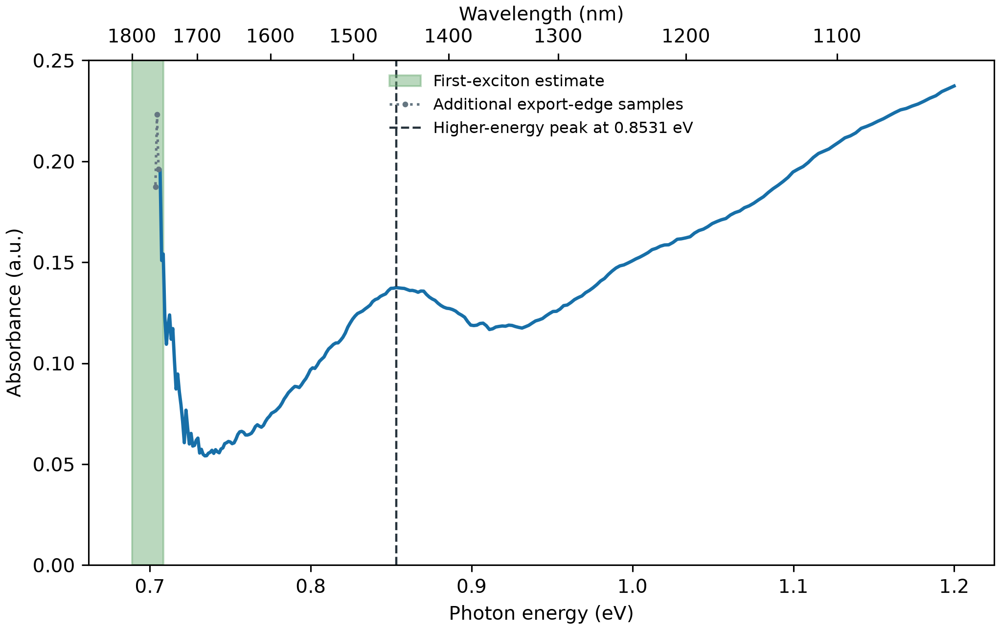
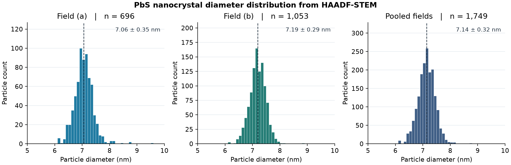
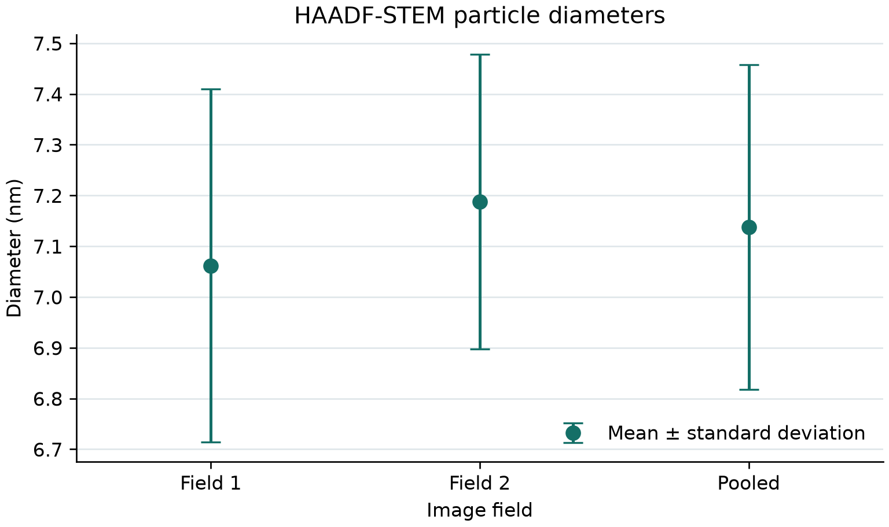
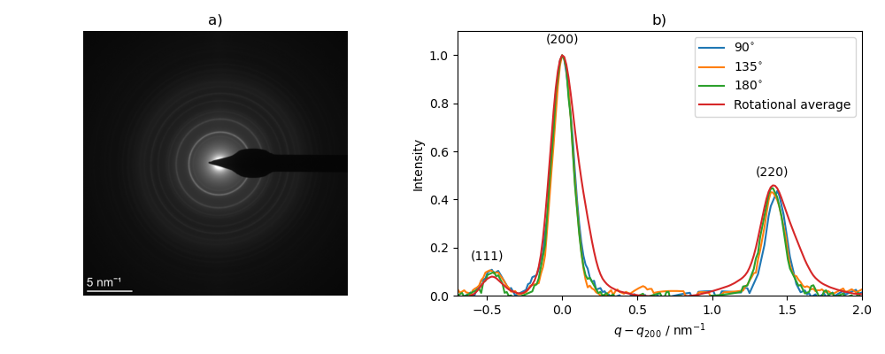
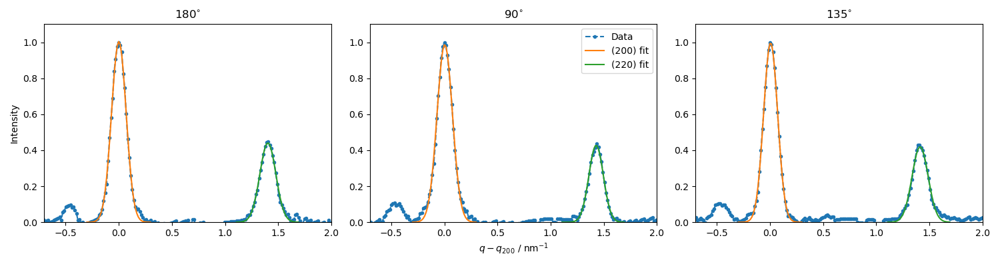
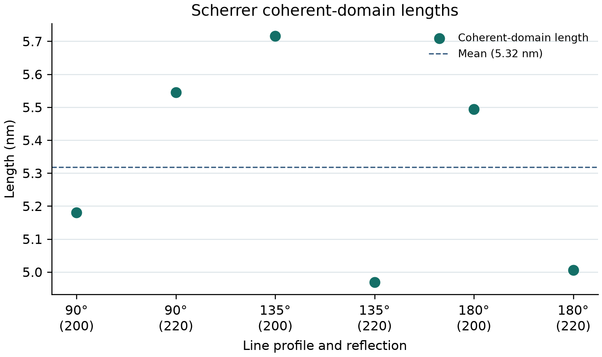
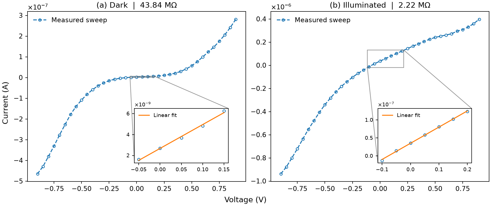

# PbS Nanocrystal Photoconducting Detectors

**Anmol Chahal**  
Materials Science and Engineering · Friedrich-Alexander-Universität Erlangen-Nürnberg

## Introduction

Lead sulfide (PbS) colloidal quantum dots offer a solution-processable material for near-infrared photodetection. Quantum confinement shifts the lowest excitonic transition to higher energies as the nanocrystal diameter decreases, making the absorption range tunable through synthesis. In a photoconducting film, the spacing and surface chemistry of adjacent dots also influence charge transport. Exchanging long oleate ligands for shorter iodide-containing ligands reduces the barrier to interdot transport. These optical and electrical effects motivate characterizing the nanocrystals and the finished device at different stages of the project. [Moreels et al.](https://doi.org/10.1021/nn900863a) · [Killilea et al.](https://doi.org/10.1002/adfm.201807964)

This project characterizes PbS nanocrystal size and structure through infrared absorption, high-angle annular dark-field scanning transmission electron microscopy (HAADF-STEM), and selected-area electron diffraction (SAED). Dark and illuminated current–voltage sweeps and calibrated photocurrent spectra establish the near-infrared response of a PbS film on interdigitated gold electrodes. The colloid and device measurements concern separate PbS batches.

## Results

### Infrared absorbance and optical diameter

Absorbance was calculated from dark-corrected sample and reference counts. The higher-energy absorption maximum is **0.853134 eV** at **1453.28 nm**. The first exciton is unresolved at the usable long-wavelength edge. Applying Moreels Eq. (1) to the estimated **1750–1800 nm** interval gives an optical diameter of **7.2098–7.5706 nm**. [Python](analysis/absorbance.py) · [Input CSV](data/raw/absorbance.csv) · [Processed spectrum](replicated/absorbance_recalculated.csv) · [Peak and diameter results](replicated/absorbance_summary.json)

### HAADF-STEM particle-size distribution

The two image fields were processed with FFT band-pass filtering, thresholding, and particle segmentation in ImageJ. The projected area $A$ of each segmented object defines an area-equivalent diameter $d=2\sqrt{A/\pi}$.

| Image field | Mean diameter (nm) | Standard deviation (nm) |
| --- | ---: | ---: |
| Field 1 | 7.0620 | 0.3479 |
| Field 2 | 7.1878 | 0.2904 |
| Pooled | **7.1378** | **0.3204** |

The Python histogram uses 0.1 nm bins digitized from the displayed HAADF-STEM histograms. The bins contain **1,749 particles** across both fields, with a bin-midpoint mean and sample standard deviation of **7.1378 ± 0.3209 nm**. Dashed lines mark the bin-midpoint means. [Histogram Python](analysis/particle_histogram.py) · [Histogram bins](data/reported/tem_histogram_bins.csv) · [ImageJ CSV analysis](analysis/microscopy.py) · [Diameter statistics](data/reported/tem_summary.csv)

### Electron diffraction and coherent-domain size

The {111}, {200}, and {220} diffraction rings are consistent with rock-salt PbS.

Directional profiles at **90°**, **135°**, and **180°** were used for width analysis. The Scherrer relation $L=K/\Delta q$, with $K=0.89$, gives a mean apparent coherent-domain length of **5.32 nm** across the six fitted widths. Instrumental broadening and diffraction-ring ellipticity can affect the apparent length.

The Python calculation takes the fitted full widths at half maximum as input. [Python](analysis/microscopy.py) · [Peak-width CSV](data/reported/scherrer_peaks.csv)

### Dark and illuminated current–voltage response

The near-zero-bias slope gives differential resistances of **43.8383 MΩ in the dark** and **2.2230 MΩ under illumination**. The approximately **19.7-fold** resistance decrease quantifies the photoconductive response. [Python](analysis/iv.py) · [Dark sweep](data/raw/iv_dark.csv) · [Illuminated sweep](data/raw/iv_light.csv) · [Fit parameters](replicated/iv_summary.json)

### Spectral responsivity and detectivity

Photocurrent was obtained from the lock-in voltage across the **1 MΩ** load. The Step-45 power calibration was scaled from the **1 mm** aperture to the **0.08 mm²** active area and aligned to the detector scan at the shared wavelengths.

| Detector parameter | Value |
| --- | ---: |
| Peak current responsivity | **0.0796078 A/W at 1260 nm** |
| Long-wavelength half-maximum cutoff | **1339.73 nm** |
| Peak Johnson-noise-limited specific detectivity at 300 K | **1.15823 × 10¹¹ Jones** |
| Johnson-noise-limited NEP at the responsivity peak | **2.4420 × 10⁻¹³ W/√Hz** |

Detectivity and NEP use the Johnson-noise model at 300 K and the fitted dark resistance. [Python](analysis/detector.py) · [Photocurrent CSV](data/raw/photocurrent_scan.csv) · [Power calibration CSV](data/raw/pyrometer.csv) · [Calibrated spectrum](replicated/detector_spectrum.csv) · [Detector parameters](replicated/detector_summary.json)

## Run the Python analysis

With Python 3.10 or newer, run from the repository root.

~~~sh
python -m pip install -r requirements.txt
python analysis/replicate.py --output-dir results
python analysis/microscopy.py --out-dir results
python analysis/particle_histogram.py --output-dir results
~~~

The optical and electrical pipeline reads the instrument CSVs, fits the I–V sweeps, then uses the dark resistance to calculate spectral detectivity. The microscopy commands calculate the coherent-domain lengths from the fitted widths and plot the field and pooled diameter distributions. [Instrument data](data/raw/) · [Calculation details](replicated/) · [Python scripts](analysis/)

To calculate diameters and plot a histogram from individual calibrated ImageJ areas in nm², supply a CSV with an **Area** column for each field.

~~~sh
python analysis/microscopy.py --out-dir results/imagej \
  --particles-csv field_1.csv --particles-csv field_2.csv --area-unit nm2
~~~

For pixel-area exports, use **--area-unit px2 --nm-per-pixel SCALE** with a common calibration for the supplied fields.

## References

- Moreels et al., *ACS Nano* **3**, 3023–3030 (2009). Empirical PbS diameter calibration. [Paper](https://doi.org/10.1021/nn900863a)
- Killilea et al., *Advanced Functional Materials* **29**, 1807964 (2019). PbS ligand-shell photoconductor design. [Paper](https://doi.org/10.1002/adfm.201807964)
- De Iacovo et al., *Applied Physics Letters* **111**, 211104 (2017). Experimental noise characterization of PbS photoconductors. [Paper](https://doi.org/10.1063/1.5005805)
