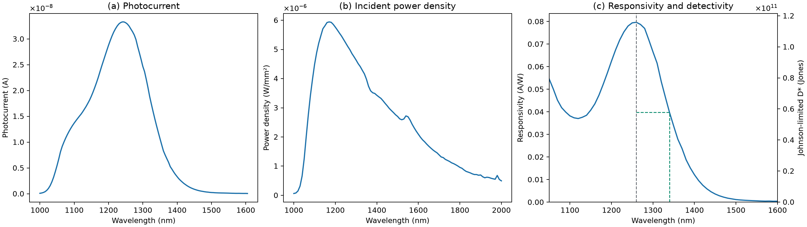

# PbS Nanocrystal Photoconducting Detectors

**Anmol Chahal**

Optical and electrical characterization of colloidal lead sulfide (PbS) nanocrystals and a near-infrared photoconductor. The analysis uses spectrometer counts, current–voltage sweeps, and calibrated detector scans. The colloid and the photoconductor used separate PbS batches.

## Results

| Quantity | Value |
| --- | ---: |
| Higher-energy absorbance peak | 0.853134 eV at 1453.28 nm |
| Diameter estimated from the first exciton | 7.2098–7.5706 nm |
| HAADF-STEM particle diameter, mean ± SD | 7.1378 ± 0.3204 nm |
| Mean Scherrer coherent-domain length | 5.3183 nm |
| Dark / illuminated differential resistance | 43.8383 / 2.2230 MΩ |
| Peak responsivity | 0.0796078 A/W at 1260 nm |
| Long-wavelength half-maximum cutoff | 1339.73 nm |
| Peak Johnson-limited specific detectivity | 1.15823 × 10¹¹ Jones at 300 K |

The first-exciton maximum is unresolved at the long-wavelength edge of the scan. The diameter estimate applies Moreels Eq. (1) to a 1750–1800 nm interval. Detectivity uses a Johnson-noise model with the fitted dark resistance. [Moreels et al.](https://doi.org/10.1021/nn900863a)

[Infrared absorbance](replicated/ir-absorbance.png) · [Dark and illuminated I–V](replicated/current-voltage.png) · [Processed tables and methods](replicated/)

## Run the analysis

Use Python 3.10 or later with the [instrument CSVs](data/raw/).

~~~sh
python -m pip install -r requirements.txt
python analysis/replicate.py --output-dir results
~~~

The pipeline calculates absorbance from dark-corrected counts, fits the near-zero-bias I–V curves, and calibrates responsivity and detectivity on the shared wavelength grid. It saves the three figures, processed CSVs, and numerical summaries.

The microscopy workflow uses the available particle statistics and diffraction peak widths. Particle-level histograms can be generated from calibrated ImageJ area exports. [Microscopy analysis](analysis/microscopy.py) · [Particle and diffraction inputs](data/reported/)

## References

- Moreels et al., *ACS Nano* **3**, 3023–3030 (2009). Empirical PbS diameter calibration. [Paper](https://doi.org/10.1021/nn900863a)
- Killilea et al., *Advanced Functional Materials* **29**, 1807964 (2019). PbS ligand-shell photoconductor design. [Paper](https://doi.org/10.1002/adfm.201807964)
- De Iacovo et al., *Applied Physics Letters* **111**, 211104 (2017). Experimental noise characterization of PbS photoconductors. [Paper](https://doi.org/10.1063/1.5005805)
