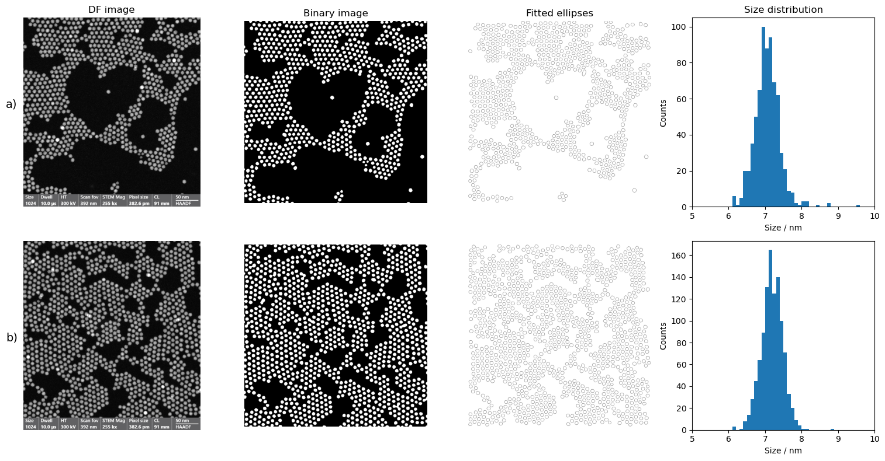
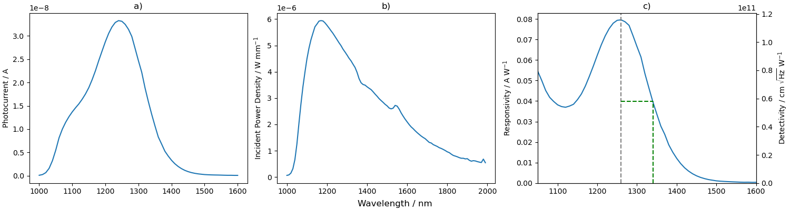

# PbS Nanocrystal Photoconducting Detectors

Results and Python analysis from a materials science and engineering project on near-infrared lead sulfide (PbS) nanocrystal photoconductors. Optical absorption, HAADF-STEM and selected-area electron diffraction (SAED) characterized one synthesized PbS batch. Electrical and spectral measurements used a photoconductor fabricated from a separate PbS batch.

## Results

| Measurement | Result |
| --- | --- |
| HAADF-STEM diameter, pooled across two image fields | 7.1378 ± 0.3204 nm (mean ± SD) |
| Diameter inferred from first-exciton absorption | Approximately 7.2–7.6 nm, estimated beyond the usable spectral edge |
| Apparent coherent-domain length from SAED peak widths | 5.3183 nm, mean of six Scherrer estimates |
| Dark and illuminated differential resistance near zero bias | 43.84 MΩ and 2.22 MΩ |
| Peak current responsivity | 0.0796 A/W at 1260 nm |
| Long-wavelength cutoff | Approximately 1340 nm at half the peak responsivity |
| Peak Johnson-noise-limited specific detectivity | \(1.1582 \times 10^{11}\) Jones (model estimate at 300 K) |

The diffraction rings were consistent with rock-salt PbS. The Scherrer calculation used a shape factor of 0.89 and the fitted line-profile widths. The image-based diameter measures projected particle size, while the Scherrer estimate describes coherent scattering length and can be lowered by uncorrected broadening. The Johnson estimate uses the dark differential resistance and excludes additional operating noise.

### HAADF-STEM particle sizing

Source: project team report, Fig. 11. The image-based standard deviations describe the observed particle-size spread. The Python analysis produces a [mean-and-SD comparison](figures/tem-reported-summary.png) and a [Scherrer length comparison](figures/scherrer-comparison.png).

### Photoconductor spectral response

Source: project team report, Fig. 15. See also the [colloid absorbance](figures/ir-absorbance.png), [SAED profiles](figures/electron-diffraction.png), [diffraction peak fits](figures/diffraction-line-fits.png), and [dark and illuminated I–V curves](figures/current-voltage.png).

## Run the analysis

Use Python 3.10 or later. The scripts read the values transcribed from the project report and write summaries and plots to the local results directory.

~~~sh
python -m venv .venv
source .venv/bin/activate
python -m pip install -r requirements.txt
python analysis/detector.py --output-dir results/detector
python analysis/microscopy.py --out-dir results/microscopy
~~~

The detector script recomputes the Johnson current noise, noise-equivalent power, and specific detectivity from the reported detector area, dark resistance, temperature, and peak responsivity. The microscopy script plots reported diameters with their standard deviations and recomputes the Scherrer lengths from the fitted widths.

### Analyze original exports

For spectral data, supply a CSV with wavelength in nm, photocurrent amplitude in A, and optical power in W measured at the calibration aperture. Use the headers **wavelength_nm**, **photocurrent_a**, and **aperture_power_w**. The power is scaled from the 1 mm diameter aperture to the 0.08 mm² active area under the assumption of representative irradiance.

~~~sh
python analysis/detector.py --spectra /path/to/spectrum.csv --output-dir results/detector
~~~

For particle sizes, supply ImageJ particle tables with an **Area** column. Use one CSV per calibrated image field. The script converts each projected area to an area-equivalent circular diameter and builds the pooled size histogram.

~~~sh
python analysis/microscopy.py --out-dir results/microscopy \
  --particles-csv /path/to/field-a.csv \
  --particles-csv /path/to/field-b.csv --area-unit nm2
~~~

Use **--area-unit px2 --nm-per-pixel SCALE** for pixel-area exports. Run separately for images with different pixel scales. The ImageJ exports should already reflect the particle segmentation and filtering for each field.

## Data provenance

The [reported values](data/reported/) and [original and recalculated figures](figures/) draw on the project team report *PbS Nanocrystal Photoconducting Detectors* (2025), pp. 7–10, Table 1 and Figs. 10–15. The original measurement tables, per-particle data, and Python files were unavailable in the project materials. The Python workflows here were implemented from the reported methods. Anmol Chahal prepared this repository from the project team's shared measurements, figures, and analysis.
